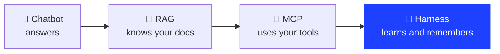
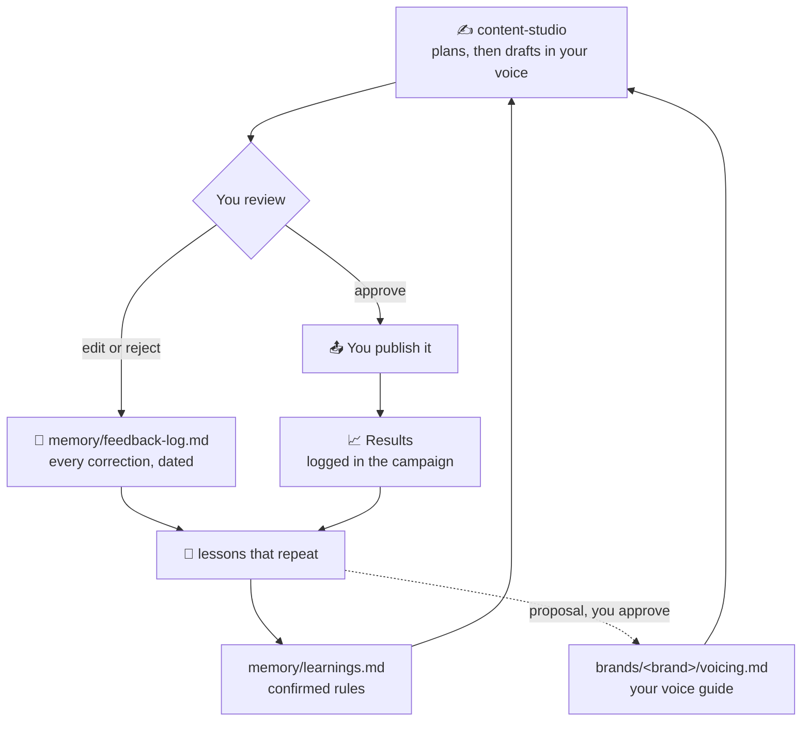

<div align="center">

# Content Studio

**An open source content team that runs in Claude Code. It learns your voice, plans every piece with you, and
remembers every correction.**

Posts, carousels, motion graphics videos and SEO articles, for one brand or several. You press publish.


</div>

---

## Why a harness?

Send a message, it's a chatbot. Give it a document, that's RAG: the model is now grounded.
Give it access to your tools, that's MCP: it can act on your behalf.

**Build a system around it so it curates itself, learns over time and remembers: that's a harness.**



Content Studio is the harness I use every day for my own brands. This repo is the tool itself, in full.

---

## What it does

| | |
|---|---|
| 🎙️ **Learns your voice** | Reads your site and your best posts, interviews you, then writes a voice guide per brand |
| 🗺️ **Plans before it writes** | Every piece starts as a plan: idea, key message, goal, why, target, fit check. You say OK first |
| ✍️ **Posts and carousels** | Three hooks, one draft, one version per platform (LinkedIn, Instagram, X) |
| 🎬 **Motion videos** | Launch films, explainers, product films and UI loops, rendered in code with Remotion from your brand colors and fonts |
| 🔎 **SEO articles** | Research from Google Search Console, an article in your voice, shipped as a pull request on your site that you merge |
| 🧪 **Checks every word** | A humanize gate blocks AI tells, em dashes and "translated" French before you see a draft |
| 🔁 **Remembers corrections** | Every edit you make is logged. Twice the same lesson, and it becomes a rule |
| 🛑 **Never publishes** | You get copy-ready text, videos and PRs. You stay the one who presses publish |

---

## The loop



One correction is an anecdote. Two is a pattern. Your voice guide only changes when you say yes.

---

## Quickstart

You need [Claude Code](https://claude.com/claude-code), git and Python 3. For videos: Node.js 18 or newer.

```bash
git clone https://github.com/Ferez22/content-studio.git
cd content-studio
claude
```

Then type:

```
onboarding
```

Onboarding walks you through, one step at a time, and can be paused and resumed (about 30 to 60 minutes in total):

1. your profile (chat language, platforms, who validates);
2. the tools: it links the studio skills into Claude (`scripts/install-skills.sh`) and lists the third-party skills
   it uses (`skills/third-party.md`), installed only after you say OK;
3. your global voice, then your first brand (positioning, audience, tone);
4. its logo, colors and fonts (drop them in `brands/<brand>/_inbox/`);
5. your first three requests.

After that, just ask: "a LinkedIn post about X for my brand", "a launch video for our new feature", "an SEO article
about <keyword>".

---

## Your data stays yours

Your brands, campaigns, memory, voice guide and profile are gitignored (see `.gitignore`). They live in your folder
and never land in a commit, so you can pull updates of the tool without mixing them with your work. Want them
versioned? Keep a private copy and remove those lines from `.gitignore` there.

---

## What's inside

```
content-studio/
├── CLAUDE.md                 🧭 the rules: routing, hard rules, gates, memory loop
├── soul.md                   who the agent is, its quality bar, what it never does
├── content-types.md          why we publish: 8 content types and their formats
├── platforms.md              specs per platform (sizes, lengths, safe zones)
├── knowledge/                reference tables (audience desires, buyer types); add your own
├── brands/example/           demo brand for the video template (your brands sit next to it, local)
├── prompts/mine/             motion video prompts: launch story, launch hype, explainer, product film, UGC ad, UI moment
├── remotion/                 the video engine (React, rendered locally)
├── scripts/install-skills.sh links the skills into Claude
└── skills/
    ├── onboarding/           🎙️ first run, resumable checklist
    ├── brand-voice/          positioning, personas, voice guide per brand
    ├── content-studio/       ✍️ brief, strategy, spec, production, review, archive
    ├── brand-assets/         logos, brand book, fonts -> charte + render theme
    ├── motion-video/         🎬 pick a prompt, storyboard, render, check, loop
    ├── seo-writer/           🔎 GSC research, article, pull request
    ├── humanize/             🧪 built-in checker: check.py + EN and FR lexicons
    └── fr-human/             native French writing method + checker
```

| Skill | When it runs | What you get |
|---|---|---|
| `onboarding` | first run, or "onboarding" | your profile, voice and first brand, step by step |
| `brand-voice` | "add a brand", positioning, tone | `brand.md`, `voicing.md`, `strategie.md`, validated by you |
| `content-studio` | "write a post about...", "a campaign for..." | a plan to approve, then hooks, drafts and platform versions |
| `motion-video` | "a launch video", "an animated explainer" | a storyboard to approve, then a rendered MP4 with a contact sheet |
| `seo-writer` | "an article about...", "why is my traffic down?" | GSC research, a brief, then a pull request on your site repo |
| `brand-assets` | you drop files in `_inbox/` | filed assets, `charte.md` and `theme.json` diffs to approve |
| `humanize` | before any text reaches you | a clean draft, or the list of what to fix |
| `fr-human` | any French text | French written natively, checked before you see it |

For English, `li-human` (third-party, see `skills/third-party.md`) adds a second pass with an AI-detection score.

---

## Gates

Nothing is produced without your OK at each gate: post plan, brief, plan, spec and budget, final. Paid tools always
come with a cost estimate first. Every OK is logged with its date in the campaign's `decisions.md`.

---

## Optional connectors

None is required to start. Each one is set up when a request first needs it:

- **Google Search Console** (SEO research, read-only)
- **Firecrawl** (reads your site and competitors' sites; paid per page)
- **ElevenLabs** (voice-over, music, sound effects; paid)
- **Higgsfield** (AI images and video; paid)

---

## Videos

```bash
cd remotion
npm install
npm run studio
```

Every `brands/<brand>/theme.json` becomes a brand and gets a `<brand>-test` composition (`example-test` out of the
box). Every `remotion/src/videos/<id>/Video.tsx` that exports `video` is registered on its own. Remotion is free for
individuals and companies up to 3 people; larger companies need a
[Remotion company license](https://www.remotion.dev/license).

---

## License

MIT. Use it, fork it, build on it. A link back is always appreciated.

Made by [Fares Aouani Cherif](https://www.faresaouani.com/en/blog/content-studio).
